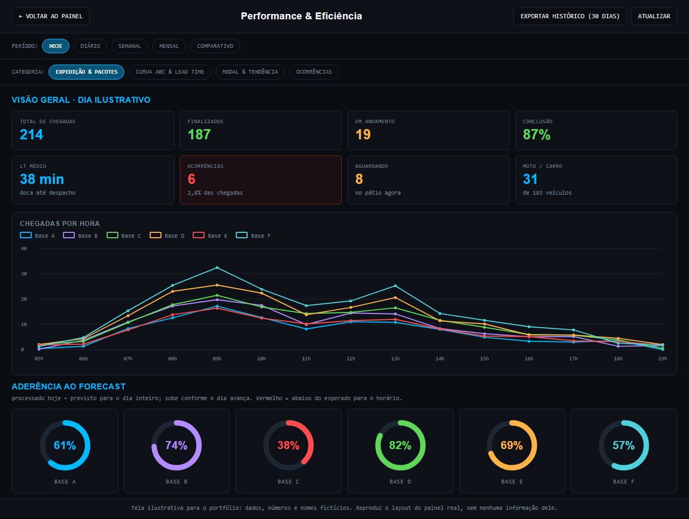
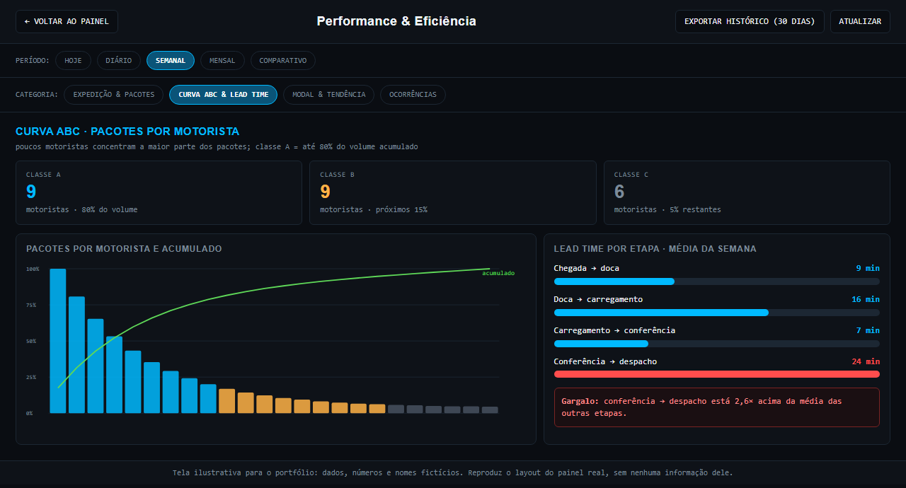
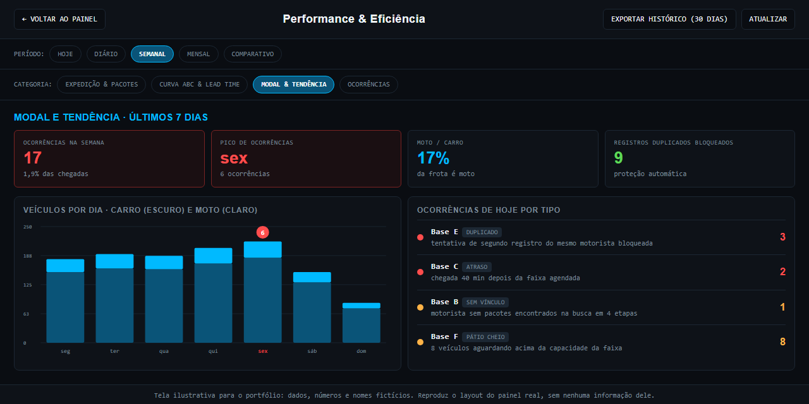
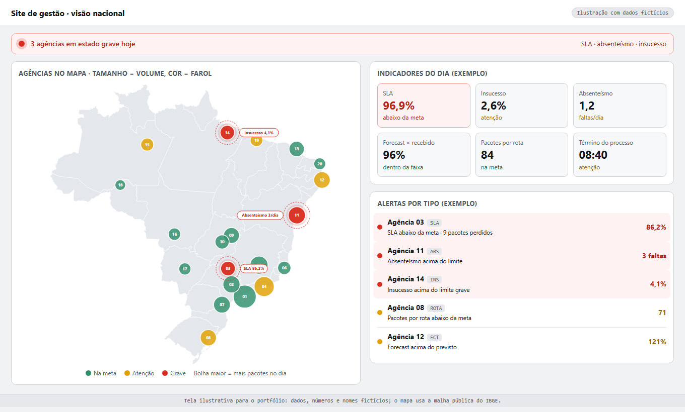
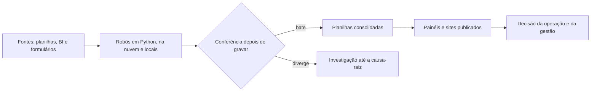

<div align="center">

# Bruno Torres

**Analista de Performance e Perdas · Operações Logísticas**

Automação, painéis e qualidade de dados para uma operação logística de grande escala, com a origem e a conferência de cada número à vista.


[**Ver o site do portfólio**](https://brunosp2010-ops.github.io/portfolio/) · [LinkedIn](https://www.linkedin.com/in/bruno-s-torres) · brunosp2010@gmail.com


</div>

## Em números

| | |
|---|---|
| **−91%** | tempo ativo da rotina diária de indicadores: 4 h → cerca de 20 min, soma das etapas |
| **156/157** | células idênticas no check-up, com a divergência rastreada até a causa |
| **11** | robôs agendados em nuvem, mais 21 tarefas locais ativas |
| **93** | testes automatizados: 50 no núcleo, 43 no site de gestão |
| **≈950** | scripts, cerca de 90 mil linhas (inventário de 22/10/2026) |

## Projetos

Cada página explica o problema, a arquitetura com diagrama, as decisões e o resultado.

| Projeto | O que resolve | Resultado |
|---|---|---|
| [Rotina diária única de indicadores](projetos/rotina-diaria.md) | Dezenas de tarefas isoladas viraram uma execução só | −91% de tempo ativo, em 14 etapas |
| [Painel de chegada de motoristas](projetos/painel-chegada-motoristas.md) | Quem chega, quem falta e quantos pacotes cada motorista leva, hora a hora | Multi-base em produção, sincronizado a cada 15 s |
| [Painel operacional do país](projetos/painel-operacional-nacional.md) | Consolidado nacional gerado e publicado todo dia | 2 h → 0 de edição manual |
| [Auditoria de insucessos por geolocalização](projetos/auditoria-insucesso-geolocalizacao.md) | Confere se o insucesso foi registrado perto do endereço | Ranking diário, com distância como sinal para revisão |
| [Site de gestão que se atualiza sozinho](projetos/site-gestao.md) | Mapa nacional com alertas, a partir de planilhas regionais | 43 testes e 0 divergências contra o protótipo validado |
| [Automações em nuvem com painel de controle](projetos/automacoes-nuvem.md) | Robôs que saíram de um computador para a nuvem | 11 robôs; o painel revelou 3 jobs que nunca executavam |
| [Governança do backlog de pacotes](projetos/governanca-backlog.md) | Registro de quem mudou o quê | Log que só acrescenta linhas; a edição humana vence o robô |
| [Dashboards de BI sem alterar o modelo](projetos/dashboards-bi.md) | Visões novas para gestores sem mexer na camada de modelagem | 5 dashboards validados contra outra fonte |

## Telas

Telas ilustrativas: dados, números e nomes são fictícios.

| Painel de chegada: visão geral | Painel de chegada: curva ABC e lead time |
|---|---|
|  |  |

| Painel de chegada: modal e ocorrências | Site de gestão: mapa com alertas |
|---|---|
|  |  |

## Como as soluções se encaixam



## Competências

| Área | Ferramentas |
|---|---|
| **Dados e automação** | Python (pandas, gspread, Playwright, requests, FastAPI), SQL (Redshift e Postgres), Sheets API, Apps Script |
| **BI e monitoramento** | Looker (API e Explores), Grafana, modelagem de KPIs |
| **Análise geoespacial** | Distância Haversine, geocodificação, mapas SVG |
| **Nuvem e entrega** | Google Cloud (Cloud Run Jobs, Scheduler, Secret Manager, Cloud Build, Vertex AI), Docker, Firebase |
| **Qualidade** | pytest, unittest, trava de escrita, backups, conferência pós-gravação |
| **IA generativa** | Claude, Gemini, GPT, DeepSeek e Manus, cada um no tipo de tarefa em que rende mais |

## Princípios de engenharia

1. **Ler antes de gravar:** todo script começa em simulação.
2. **Nunca sobrescrever trabalho humano:** a edição manual vence o robô.
3. **Conferir depois de gravar:** releitura e comparação a cada lote.
4. **Backup antes de mudar estrutura:** o original fica como referência.
5. **Localizar por rótulo:** nunca por número de linha ou de coluna.
6. **Falhar de forma visível:** código de saída honesto, nenhuma falha silenciosa.
7. **Documentar para quem vem depois:** README, central de comandos e logs por dia.
8. **Confirmar antes do que é pesado:** data, volume e destino à vista antes de rodar.

## Sobre este repositório

Este repositório descreve **como cada solução funciona**. Não contém código de produção, dados, nomes de empresas, clientes ou sistemas internos.

```text
index.html      site do portfólio
projetos/       uma página por projeto, com diagrama
img/            prévia do site e telas ilustrativas
foto_bruno.jpg  retrato
```

## Contato

- E-mail: brunosp2010@gmail.com
- LinkedIn: [linkedin.com/in/bruno-s-torres](https://www.linkedin.com/in/bruno-s-torres)
- GitHub: [github.com/brunosp2010-ops](https://github.com/brunosp2010-ops)
