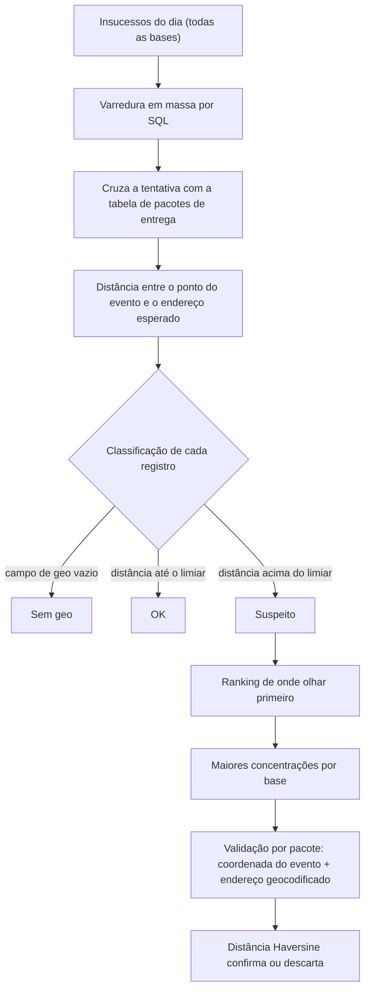

# Auditoria de insucessos por geolocalização

Verificação automática de que a classificação de insucesso de uma entrega (destinatário ausente, endereço errado, recusa) foi feita perto do endereço de entrega, e não de outro lugar.

## O problema

Quando um motorista classifica uma entrega como "destinatário ausente" ou "endereço errado" estando **longe do endereço**, é sinal de que pode não ter ido até lá.

Não havia como auditar isso em escala. Olhar pacote por pacote na interface não funcionava para o volume diário.

## Como funciona

Duas camadas, da mais ampla para a mais precisa:

### 1. Varredura em massa por SQL

- Percorre **todos** os insucessos do dia, por base, em blocos.
- Cruza cada tentativa com a tabela de pacotes de entrega e traz a **distância entre onde o motorista registrou o evento e o endereço esperado**.
- Classifica cada registro em **sem geo**, **OK** ou **suspeito**, com limiar de distância configurável.
- Agrega os resultados e lista onde há mais ocorrências suspeitas.
- Guarda todos os registros, e não só os suspeitos, em um arquivo local indexado por data e base. Dá para reconsultar sem voltar à fonte.

### 2. Validação por pacote

Para as maiores concentrações de cada base, o robô valida alguns pacotes no sistema de origem:

1. Abre o histórico do pacote e localiza o evento de tentativa real (entregue ou não entregue). Eventos de movimentação interna ficam de fora, porque não aconteceram na rua.
2. Lê a **coordenada exata** de onde o motorista registrou o evento.
3. **Geocodifica o endereço** do destinatário com OpenStreetMap, sem chave de API.
4. Calcula a **distância Haversine** entre as duas coordenadas.

A fonte só fornece a coordenada do evento. A comparação com o endereço é feita pelo robô.

## Decisões de engenharia

| Decisão | Por quê |
|---|---|
| Análise agregada por SQL em vez de caso a caso na interface | Rodar a análise agregada e sinalizar a distância suspeita é mais confiável e escala. |
| Duas camadas | O SQL cobre tudo e é rápido, mas a cobertura de geolocalização é parcial. A validação por pacote tem fonte mais completa, mas custa de 20 a 40 segundos por pacote, então roda só nas maiores concentrações. |
| Limiar configurável | A distância aceitável varia com o tipo de endereço. O valor fica em um parâmetro, e não no código. |
| Somente análise | O robô não grava nas planilhas. Imprime o resumo e salva o registro local, e a decisão sobre o que fazer fica com uma pessoa. |
| Validar à mão antes de automatizar | Dois casos reais foram conferidos manualmente antes de qualquer automação. |

## Limites assumidos

- A cobertura de coordenada na fonte em massa é parcial. O que vem sem coordenada aparece como "sem geo", e o robô não tenta adivinhar.
- Distância longe do endereço é **sinal para revisão**, e não prova de irregularidade. Há casos legítimos, como prédios grandes, condomínios com portaria distante e falha de GPS.
- O geocodificador gratuito tem limite de cerca de 1 requisição por segundo, o que limita o volume da validação por pacote.

## Resultado

Uma forma repetível de auditar a qualidade da classificação de insucesso: um ranking diário de onde olhar primeiro, com evidência de distância, no lugar de uma busca manual sem critério.

**Stack:** Python, SQL, Playwright, distância Haversine, OpenStreetMap.

---

[← Todos os projetos](../README.md)
