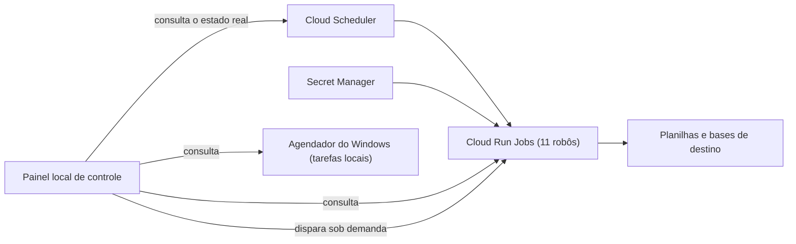

# Automações em nuvem com painel de controle

Migração de robôs que rodavam só em um computador para a nuvem, com um painel que mostra o estado real de cada um e permite dispará-los.

## O problema

Os robôs dependiam de um único computador, e falhas silenciosas de permissão, sessão e codificação de texto passavam semanas sem que ninguém visse.

## Como funciona

- **Cloud Run Jobs** com **Scheduler** e segredos no **Secret Manager**, em vez de senhas no código.
- **Painel local:** consulta o estado real do agendador do Windows, do Cloud Run e do Scheduler, e dispara cada robô.
- **Documentação viva** gerada por script, com uma central de comandos que lê as opções direto dos scripts.

## O que o painel revelou

- **3 jobs sem permissão de invocação**, que pareciam agendados mas nunca executavam.
- **5 tarefas locais com o caminho corrompido por acento**, que nunca rodaram.

Ambos eram falhas silenciosas, invisíveis sem uma visão consolidada do estado real.

## Resultado

11 robôs em nuvem, mais 21 tarefas locais ativas, todos visíveis em um só painel.

**Stack:** Google Cloud, Docker, PowerShell, Python.

---

[← Todos os projetos](../README.md)
