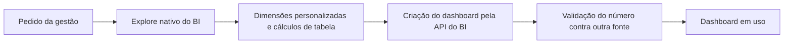

# Dashboards de BI sem alterar o modelo

Dashboards de SLA por região, densidade de rotas, produtividade hora a hora e gestão regional, montados sem acesso à camada de modelagem do BI.

## O problema

Gestores pediam visões novas, mas a camada de modelagem do BI é compartilhada e não está sob o meu controle. A solução precisava existir sem alterá-la.

## Como funciona

- **Explores nativos:** a consulta parte dos campos que já existem no modelo.
- **Dimensões personalizadas e cálculos de tabela** cobrem o que o modelo não traz, por exemplo agrupar por faixa.
- **API do BI:** um cliente HTTP autenticado cria e ajusta os dashboards, o que dá repetibilidade que a interface não dá.
- **Filtros ligados** entre os blocos para uma leitura única.
- **Validação:** cada número foi conferido contra outra fonte antes de ir para a gestão.

## Limites reais mapeados

| Limite | Efeito | Como lidei |
|---|---|---|
| 25 blocos por dashboard | Visões grandes não cabem em uma tela | Dividir em dashboards ou abas temáticas |
| Filtro vazio apaga o filtro do bloco | A informação some sem aviso | Sempre carregar um valor padrão |

## Resultado

5 dashboards em uso. As versões enxutas carregam mais rápido e consultam menos a fonte.

**Stack:** Looker, Grafana, SQL, Python.

---

[← Todos os projetos](../README.md)
