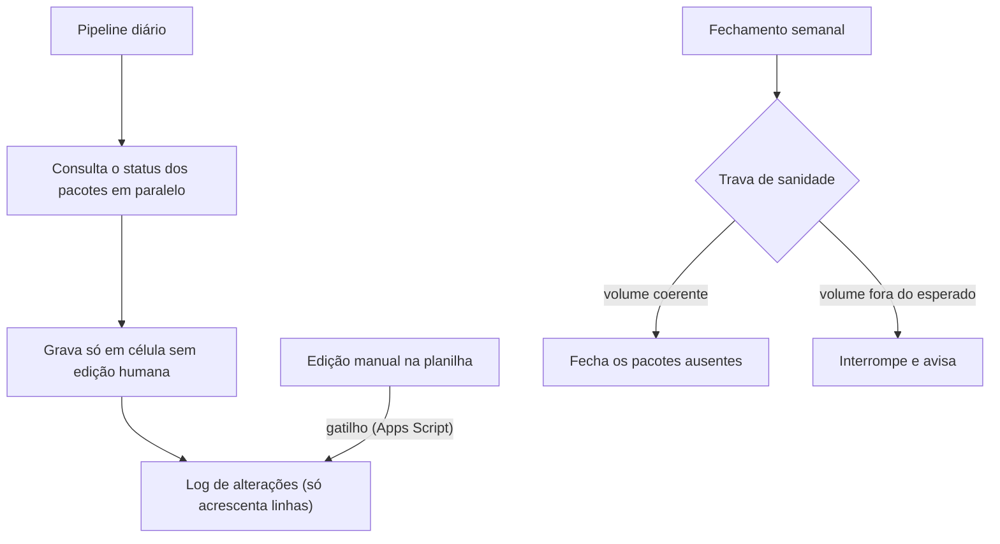

# Governança do backlog de pacotes atrasados e extraviados

Pipeline diário e fechamento semanal para uma planilha de pacotes críticos, com registro de cada alteração e uma regra clara de convivência entre robô e pessoas.

## O problema

Uma planilha manual de pacotes críticos, sem registro de quem mudou o quê, em que o robô podia sobrescrever o trabalho da equipe.

## Como funciona

### Regras de convivência

- **A edição humana vence o robô.** O robô nunca sobrescreve nota ou edição manual.
- **Log que só acrescenta linhas:** cada mudança, de robô ou de pessoa, vira uma linha nova. Um robô em Python registra as mudanças dele, e um gatilho em Apps Script registra as edições manuais.
- **Proteção real de intervalos**, com lista de editores, em vez de apenas aviso.

### Fechamento semanal com trava de sanidade

O fechamento só roda se o volume a fechar for coerente com o histórico. Fora disso, ele interrompe antes de gravar.

### Confirmação de status em blocos

Quando a ferramenta de rastreio mudou e o método rápido de consulta parou de funcionar, a confirmação foi refeita em **blocos pequenos**, com poucos processos em paralelo. Cada bloco grava ao terminar, e o trabalho pode ser interrompido sem perda.

## Causa-raiz encontrada

Uma coluna sumia da planilha a cada execução. A causa era um redimensionamento da aba com número fixo de colunas, que encolhia a grade. A correção trocou isso pelo máximo entre o atual e o necessário, em 4 scripts, e evitou uma quinta aba que ia quebrar.

**Stack:** Python, gspread, Apps Script, Playwright.

---

[← Todos os projetos](../README.md)
