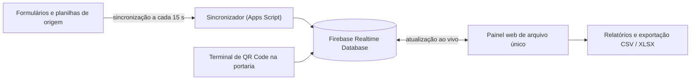
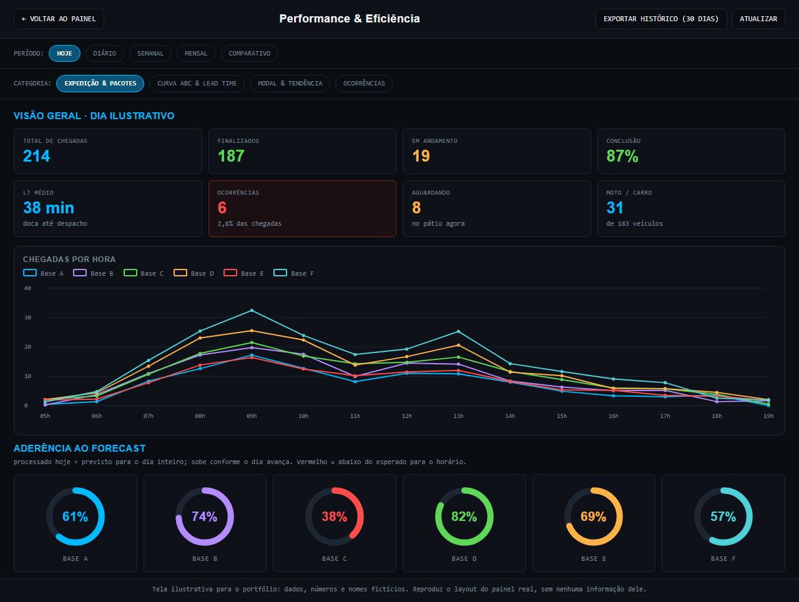
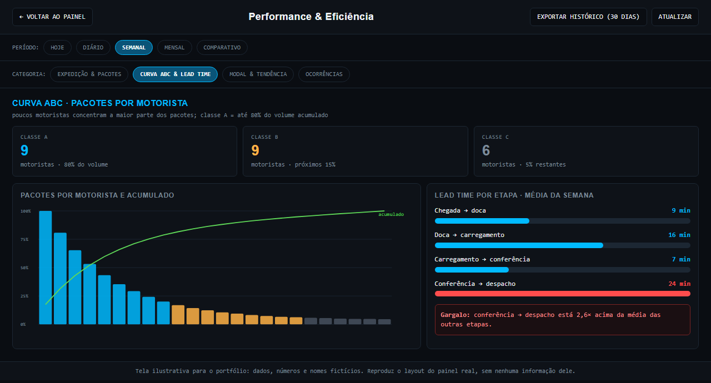
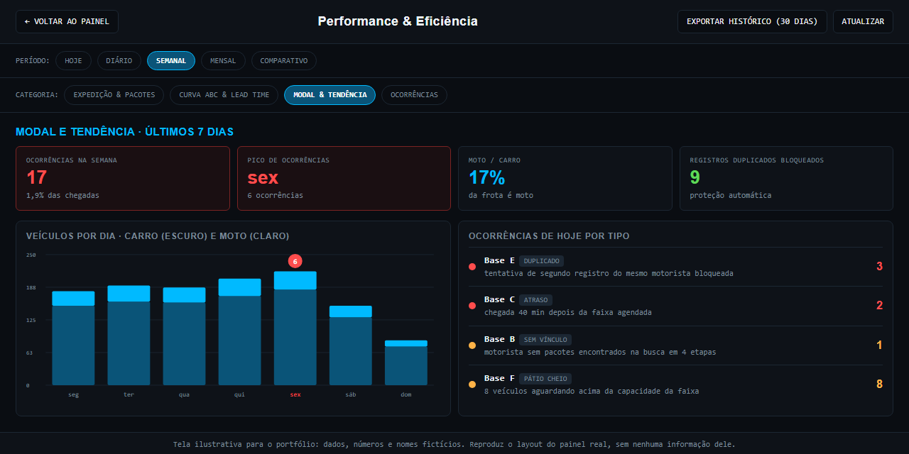

# Painel de chegada de motoristas

Aplicação web em tempo real para as bases acompanharem, hora a hora, quem está chegando, quem falta e quantos pacotes cada motorista vai levar.

## O problema

As bases não enxergavam a chegada dos motoristas ao longo do dia. A informação estava espalhada entre formulários e planilhas, e a conferência era manual.

## Como funciona

- **Arquivo único, sem build:** o painel inteiro é uma página HTML com JavaScript. Isso simplifica a publicação e a manutenção.
- **Tempo real:** o Firebase Realtime Database empurra as mudanças para todas as telas abertas.
- **Portaria:** um terminal de QR Code registra a chegada do motorista.
- **Agendamento:** capacidade por faixa de horário, para distribuir a chegada ao longo do dia.

### Cruzamento de motoristas com pacotes

Para ligar cada motorista aos pacotes que ele levará, o painel usa uma busca em **4 etapas**, da mais exata para a mais aproximada: primeiro por telefone, depois por nome, chegando à comparação por **distância de Levenshtein**, que tolera erros de digitação e variações de grafia.

## Relatórios

Curva ABC, tempo entre etapas e ocorrências, com exportação em CSV e XLSX.

## Proteções

- Contra registro duplicado do mesmo motorista.
- Contra a virada de dia, para que a chegada de um dia não contamine o seguinte.

## Telas (ilustrativas)

Aba Performance do painel, reproduzida com dados, números e nomes fictícios, no mesmo layout do painel em produção.

## Resultado

Painel multi-base em produção, com métricas de performance embutidas e dados precisos. É um sistema completo de acompanhamento, não um simples check-in.

**Stack:** JavaScript, Firebase, Apps Script, Chart.js.

---

[← Todos os projetos](../README.md)
