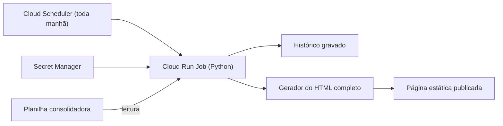

# Painel operacional do país, publicado sozinho

Um robô em nuvem consolida dezenas de abas de indicadores, calcula as métricas nacionais e publica uma página estática toda manhã, sem edição manual.

## O problema

A gestão só enxergava as bases uma a uma, sem um consolidado nacional. Montar uma visão do país exigia cerca de 2 horas de edição manual por versão.

## Como funciona

O robô calcula:

- **SLA por faixa;**
- **insucesso, com as causas;**
- **aderência de frota própria e agregada;**
- **backlog em saldo corrido.**

A página gerada tem filtro por faixa, tela por base e gráficos clicáveis com a nota do dia.

## Achados no caminho

| O que apareceu | Causa | Correção |
|---|---|---|
| O agendamento constava como criado, mas não executava | A conta do agendador não tinha permissão de invocar o job | Permissão concedida e teste ponta a ponta |
| Média nacional de SLA distorcida | Leitura do texto formatado da célula; uma célula com formato quebrado virava “1” | Leitura do valor bruto em todo o robô |

## Resultado

As cerca de 2 horas de edição manual por versão passaram a zero. A gestão tem um consolidado nacional atualizado todo dia, com histórico.

**Stack:** Python, Cloud Run, Cloud Scheduler, Secret Manager.

---

[← Todos os projetos](../README.md)
