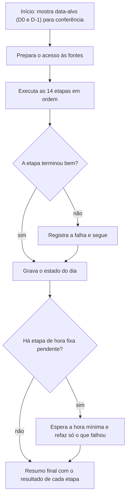

# Rotina diária única de indicadores

Orquestrador que preenche, todo dia, os indicadores de uma planilha consolidadora com dezenas de abas. Substituiu dezenas de robôs e tarefas agendadas isoladas por uma execução única, com estado e registro por dia.

## O problema

- Os robôs rodavam em horários diferentes e uma falha passava despercebida.
- Cada chamada à API da planilha leva de 2 a 20 segundos. Os robôs originais faziam em média 4 chamadas por aba (abrir, ler a linha, ler a célula, gravar e esperar 1 segundo). Uma só etapa passava de 100 chamadas.

## Como funciona

As 14 etapas cobrem: processado, escoado e coleta; atrasos por causa; SLA geral; SLA por cliente; insucessos; avarias; aderência de inventário; pacotes por rota; forecast; recebidos; atraso entre bases; escoamento nacional; e pacote por rota de um segundo grupo de bases.

Pontos de projeto:

- **D0 e D-1:** a rotina deixa à vista de qual dia cada etapa vai preencher, antes de rodar.
- **Hora mínima:** etapas cuja fonte só consolida mais tarde ficam para o fim e esperam o horário, com nova tentativa durante a espera.
- **Retomada:** o estado do dia fica em arquivo, e uma nova execução refaz apenas o que não terminou.
- **Timeout real** de socket em todas as chamadas, o que eliminou travas com 0% de CPU presas numa conexão morta.

## Decisões de engenharia

| Decisão | Por quê |
|---|---|
| Lote em vez de laço | Uma leitura e uma gravação para todas as abas. O número de chamadas deixa de depender do número de abas. Um módulo comum atende 10 scripts. |
| API em vez de navegador | Consultas diretas às APIs do BI no lugar de abrir e ler telas. Uma etapa saiu de dezenas de processos com navegador para 1 consulta. |
| Gravar só o que mudou | O robô compara antes de gravar. Os nomes das abas ficam em cache local por 7 dias. |
| Só preencher célula vazia | Notas e edições manuais nunca são sobrescritas. |
| Localizar por rótulo | A linha é achada pelo texto da coluna de rótulos, não por número fixo. |

## Como a precisão foi mantida

O modo de **divergências** roda as 14 etapas com uma trava que bloqueia qualquer escrita e compara o que cada script gravaria com o que já está na planilha. Antes de começar, a rotina testa a trava e aborta se ela não estiver bloqueando.

No check-up de 21/10/2026: **156 de 157 células idênticas**. A divergência era uma fórmula tratada como valor pela leitura otimizada. A leitura passou a respeitar fórmulas, e o ajuste ficou registrado.

## Resultado

| Etapa (20/10 antes → 21/10 depois, minutos) | Antes | Depois |
|---|---:|---:|
| SLA por cliente (2 etapas) | 58,6 | 3,6 |
| Insucessos de entrega | 32,5 | 0,7 |
| Atrasos por causa | 30,5 | 1,5 |
| Recebidos do dia | 25,4 | 0,5 |
| SLA geral | 22,7 | 1,5 |
| Forecast do dia | 18,3 | 0,3 |
| Avarias | 17,1 | 0,8 |
| Escoamento nacional | 3,0 | **8,3** |
| **Soma das etapas** | **240,2** | **22,3** |

**−91% de tempo ativo** (de 4 horas para cerca de 20 minutos). O escoamento nacional foi a única etapa que ficou mais lenta: lê uma tela de BI ao vivo e é o próximo gargalo.

> A manhã de 20/10 teve disputa de cota com outras tarefas e 3 etapas com falha, então parte da diferença vem do ambiente. Por isso o número de chamadas por etapa é o indicador estrutural do ganho.

**Stack:** Python, Sheets API, Playwright, agendador do Windows.

---

[← Todos os projetos](../README.md)
