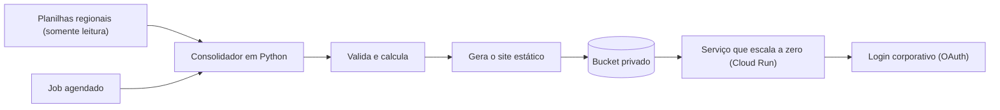
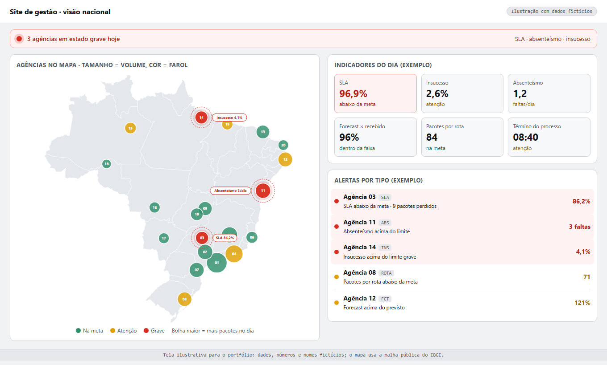

# Site de gestão que se atualiza sozinho

Visão nacional em mapa, com alertas por tipo e página por agência, mantida a partir de planilhas regionais.

## O problema

Faltava uma visão nacional em mapa, com alertas, que se mantivesse sozinha a partir das planilhas que cada região já preenche.

## Como funciona

- **Consolidador:** lê as planilhas em modo somente leitura, valida e calcula.
- **Site estático** com mapa SVG interativo, alertas por tipo (SLA, insucesso, absenteísmo e forecast) e página por agência com período livre.
- **Hospedagem enxuta:** o site fica em um bucket privado, servido por um serviço que escala a zero, com custo estimado próximo de zero.
- **Segurança:** login corporativo que **falha fechado**, ou seja, sem login válido, nada é exibido.

## Tela (ilustrativa)

Mapa nacional em bolhas, reproduzido com dados, números e nomes fictícios; a malha é a pública do IBGE.

## Qualidade

- **43 testes automatizados.**
- **0 divergências** contra o protótipo validado.

## Observação

Hoje o site opera com dados **simulados**, até as planilhas regionais passarem a receber dados reais.

**Stack:** Python, HTML e JavaScript, Cloud Run, Cloud Storage, OAuth.

---

[← Todos os projetos](../README.md)
